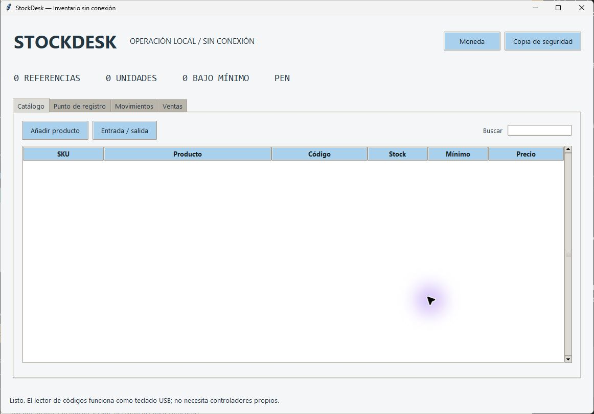

# StockDesk

Offline desktop inventory, stock ledger, sales, PDF receipts and consistent backups.

[](https://github.com/MIGUEL-MOSCOSO-DEV/stockdesk/actions/workflows/ci.yml) · [Descargas](https://github.com/MIGUEL-MOSCOSO-DEV/stockdesk/releases/latest) · [MIT](LICENSE)

Inventario y registro de ventas en una aplicación de escritorio que funciona sin conexión. Cada cambio de existencias deja un movimiento en la base local.



## Qué incluye

- Catálogo por SKU y código de barras, costos, precios y stock mínimo.
- Entradas y salidas con motivo y libro de movimientos.
- Ventas atómicas, prevención de sobreventa y anulación con devolución una sola vez.
- Recibos PDF, copia SQLite consistente y lectores de códigos que funcionan como teclado.

## Descargar para Windows

En [Releases](https://github.com/MIGUEL-MOSCOSO-DEV/stockdesk/releases/latest) encontrarás StockDesk.exe y su archivo SHA256SUMS.txt. Es una aplicación portable para Windows 10/11 de 64 bits: no necesita instalar Python ni permisos de administrador. Abre el ejecutable para iniciar. Los ejecutables no tienen firma digital.

## Ejecutar desde el código

Necesitas Python 3.11 o superior con Tkinter. Crea un entorno virtual para mantener las dependencias separadas.

```sh
git clone https://github.com/MIGUEL-MOSCOSO-DEV/stockdesk.git
cd stockdesk
python -m venv .venv
```

En Windows:

```powershell
.venv\Scripts\python.exe -m pip install .
.venv\Scripts\python.exe launch.py
```

En Linux o macOS puedes usar .venv/bin/python. Tkinter debe estar disponible en tu instalación de Python; la revisión visual y los ejecutables publicados corresponden a Windows.

## Uso

Elige tu moneda antes del primer producto. Registra el catálogo y las existencias iniciales. En Punto de registro, escribe o escanea un SKU o código y pulsa Enter para añadir unidades. Registrar venta confirma el movimiento completo. En Ventas puedes exportar su recibo o anularla; en Catálogo puedes registrar compras o salidas mediante movimientos.

- La copia de seguridad utiliza la API de SQLite y es consistente aunque la aplicación esté abierta. Debe guardarse en un archivo nuevo.
- Para restaurar una copia, cierra todas las instancias, conserva una copia del directorio actual y coloca la base respaldada como inventory.sqlite en el directorio de datos. No combines una base antigua con archivos WAL de otra ejecución.

## Datos y privacidad

La instalación comienza sin registros de demostración. Los datos locales se guardan en ~/.stockdesk (la carpeta de tu usuario). Puedes cambiar esa ubicación con la variable STOCKDESK_HOME. inventory.sqlite conserva catálogo, ventas y movimientos. No protege esos datos con una contraseña: la privacidad depende de tu cuenta y del disco del sistema.

## Alcance actual

Cantidades enteras y una moneda por base. Los recibos son registros internos, no facturas fiscales ni constancias de pago. No procesa cobros, impuestos, usuarios ni sincronización entre equipos. El catálogo no incluye edición o eliminación de productos ya creados en esta versión. Las vistas muestran hasta 500 ventas y 1000 movimientos; la base conserva el historial completo. La compatibilidad física con un lector USB depende de que emule un teclado; no se ha probado un lector conectado.

## Desarrollo y pruebas

```sh
python -m pip install . -r requirements-dev.txt
python -m ruff check .
python -m ruff format --check .
python -m unittest discover -s tests -v
```

Las pruebas usan directorios y datos temporales. GitHub Actions verifica formato y pruebas en Windows y Linux y construye un ejecutable de Windows como artefacto del workflow. No hay una aplicación web ni un servidor remoto requerido.

## Generar el ejecutable

Desde Windows, con las dependencias de desarrollo instaladas:

```sh
python -m PyInstaller --noconfirm --clean --onefile --windowed --name StockDesk launch.py
```

El resultado queda en dist/StockDesk.exe. PyInstaller construye para el sistema donde se ejecuta; para generar Windows necesitas construir desde Windows. Los archivos de compilación y los datos locales se excluyen de Git.

## Estructura

store.py mantiene catálogo, ventas y libro bajo transacciones; receipts.py genera PDF; app.py contiene catálogo, registro de ventas y vistas históricas.

## Contribuir

Abre un issue con el sistema operativo, la versión y los pasos para reproducir el problema. No incluyas archivos privados, contraseñas ni bases reales. Para cambiar reglas de negocio, añade una prueba que describa el caso.

Creado por [Miguel Moscoso](https://github.com/MIGUEL-MOSCOSO-DEV). Licencia MIT.
